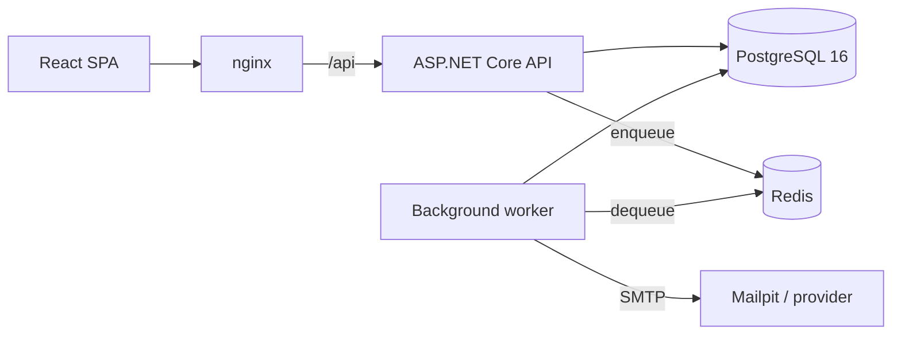

# Architecture

## System

Two processes share one codebase and one database. The API serves requests; the
worker handles work that must not block or fail a request, currently invitation
email plus four periodic maintenance passes.

nginx serves the frontend and proxies `/api`, so the browser sees one origin.
That keeps the refresh cookie first-party and removes CORS from the deployed
configuration. The Vite dev server proxies the same way.

Projects depend inward: `Api`/`Worker` → `Infrastructure` → `Application` →
`Domain`. `Domain` has no package references, which keeps the permission matrix
and membership rules testable as plain functions.

**Trade-off:** `Application` consumes EF Core `DbSet<T>` through an
`IWorkspaceDb` interface rather than custom repositories. Repositories over an
ORM tend to leak `IQueryable` or grow one method per query. The cost is that
changing ORM would touch the application layer.

## Tenancy

One database with an organization discriminator, rather than a database per
tenant: per-tenant databases make migrations and pooling an operational problem
for many small tenants. Isolation is enforced in three places.

**1. The tenant comes from the route, not from the client.** Tenant-scoped
routes live under `/api/organizations/{organizationId}` and the whole group runs
`TenantResolutionFilter`, which loads the caller's membership and pins
`ITenantContext`. Nothing in the body, headers or query string can set the
organization or the role. Because the role is read per request, a demotion or
removal applies to the caller's next call rather than at token expiry. A
non-member gets 404, not 403, so the API cannot be used to probe for other
tenants.

**2. A query filter on every tenant-owned entity.** A query that omits its own
organization predicate still returns nothing from other tenants. When no tenant
is resolved the filter compares against `Guid.Empty`, so it fails closed. Query
filters do not apply to inserts, so `SaveChangesAsync` also rejects writing a
tenant-owned row into a different organization.

Three reads legitimately cross tenants and all go through
`IWorkspaceDb.CrossTenant<T>()`, which exists so they can be found by name:

| Call site | Constrained by |
| --- | --- |
| "Which organizations am I in?" (`/auth/me`) | the caller's user id |
| Tenant resolution | the caller's user id and the requested organization |
| Invitation preview, accept, worker reads | a 256-bit single-use token hash, or the job's invitation id |

**3. The database.** `tasks` references `projects` by composite key
`(organization_id, project_id) → (organization_id, id)`, so a task in one tenant
pointing at another tenant's project cannot be represented. A partial unique
index allows one pending invitation per address per organization while leaving
accepted and revoked ones alone.

**Not done: row-level security.** It would add a layer that holds even for a
hand-written query, but with pooled connections it needs a session variable set
per transaction through an EF interceptor, and its failure mode is silent. Three
enforced layers with tests seemed better than four where one might not engage.
This is the first thing to add for a compliance requirement.

## Authentication

Access tokens are 15-minute HMAC-SHA256 JWTs carrying identity only. No role or
permission claim: a token is valid for minutes, a revoked role must apply
immediately.

Refresh tokens are 256-bit random values stored as SHA-256 hashes and rotated on
every use, with the chain sharing a `chain_id`. Presenting an already-rotated
token means it was captured, so the whole chain is revoked and the event is
audited. The token is delivered as an `HttpOnly`, `SameSite=Lax`, `Secure`
cookie scoped to `/api/auth`; it appears in the response body only when
`Auth:ReturnRefreshTokenInBody` is on, which is off by default and exists for
non-browser clients. `Lax` rather than `Strict` because invitation links arrive
from an email client.

Passwords use ASP.NET Core Identity's PBKDF2-HMAC-SHA512 at 210,000 iterations
(OWASP 2023). Argon2id is stronger but every .NET implementation is a
third-party native dependency; the verifier reports outdated parameters, so the
cost can be raised later and hashes upgrade on next sign-in. Policy follows NIST
SP 800-63B: length 12-128, no composition rules, a small deny list, and no
reuse of the user's own email or name.

Every sign-in failure returns the same message, and an unknown address still
pays for a hash verification so timing does not reveal which accounts exist. Ten
consecutive failures lock an account for 15 minutes, which is not disclosed.
Registration does report a duplicate address, which trades enumeration
resistance for usability at the one endpoint where the user needs to know.

## Authorization

Four roles map to permissions through one static matrix. Endpoints declare a
permission, never a role. The matrix is cumulative and an unmapped role grants
nothing.

Checks happen twice: an endpoint filter rejects early, and the service checks
again, so an endpoint that forgets its filter is not an open door.

Rules that depend on the target live in `MembershipRules`:

- an admin may not act on an owner or grant the Owner role;
- nobody changes their own role;
- an organization always keeps at least one owner;
- an assignee must be a member of the same organization.

Task editing is row-level: Admins and Owners hold `TaskUpdateAny`, a Member
holds `TaskUpdateOwn` and may edit only tasks they created or are assigned to.
That check needs the row, so it lives in `TaskService`.

The frontend makes no authorization decisions. It reads the caller's permission
list from `/auth/me` to decide what to render; every denial test calls the API
directly.

## Audit

Entries are written into the same change tracker as the action, so one
`SaveChangesAsync` commits both. There is no path that changes data without
recording it.

Immutability is enforced twice: the application refuses to modify or delete an
audit row, and a trigger rejects `UPDATE`, `DELETE` and `TRUNCATE`. The second
is what makes the trail evidence rather than convention.

`audit_logs` has no foreign keys, so deleting a tenant leaves its history
intact, including the record of the deletion. The actor's email is denormalized
so entries stay readable after an account is removed.

Account-level events (sign-in, failed sign-in, token replay) carry no
organization and never appear in a tenant's trail. Metadata is `jsonb` and never
holds credentials or tokens.

## Background work

Four Redis keys: `ready` (list), `processing` (sorted set by pickup time),
`scheduled` (sorted set by run time) and `dead`. Dequeue pops and records the job
in-flight in one Lua script, so a worker that dies after the pop does not lose
it; the visibility timeout returns it. Delivery is therefore at-least-once and
handlers are idempotent.

Retries use exponential backoff with full jitter (5s, 10s, 20s, 40s, capped at
15 minutes) and dead-letter after five attempts. Jitter matters when a mail
provider has an outage, or every invitation queued in that window retries in
lockstep.

Polling rather than `BRPOPLPUSH`: StackExchange.Redis multiplexes one
connection, and a blocking command would stall everything else on it.

Jobs are enqueued after the transaction commits, so the worker cannot see an
invitation that does not exist. If the enqueue itself fails, the invitation is
left pending and a periodic pass re-queues it, rotating the token first since
the original was never delivered. This is smaller than a transactional outbox:
one periodic query instead of an outbox table and dispatcher, at the cost of
noticing a lost enqueue within a minute rather than immediately. Higher volume,
or work that is money rather than email, justifies the outbox.

## Data model

- UUID v7 identifiers, generated in the application: unique but time-ordered, so
  index inserts stay at the right-hand edge, and an entity can be referenced
  before its transaction commits.
- Tasks carry `organization_id` even though it is derivable, which buys a
  uniform filter with no join and the composite foreign key above.
- Enums are stored as integers so role ordering sorts correctly, and serialized
  as names so clients never depend on a number.
- Migrations are SQL applied by EF Core. The partial index, composite key and
  audit trigger read better as DDL, and the files can be run with `psql`.
  Consequence: there is no EF model snapshot, so the next migration is written
  as SQL too.
- Organization deletion is a hard delete gated on the caller echoing the slug.
  Production would soft-delete with a retention window.

## Errors and input

Failures are RFC 9457 problem documents with a stable `code` and a
`correlationId` that also appears on the response header and on any audit rows
the request produced. Validation runs in an endpoint filter and returns 422 with
per-field messages. Unique-constraint violations map to 409 centrally, because a
check-then-insert is a race. A 500 returns the correlation id and nothing else.

Also: per-address rate limits on authentication and anonymous invitation lookup,
`nosniff`, `DENY`, `no-referrer`, a restrictive CSP and `no-store` on every
response, and forwarded headers trusted only because the API sits behind nginx
on a private network.

## Testing

Unit tests cover the permission matrix, membership rules, password policy, slug
generation, retry schedule, token issuance and queue semantics.

Integration tests run the real pipeline against a real PostgreSQL, with a
throwaway database per run. An in-memory provider has no partial indexes, no
composite foreign keys and no triggers, so it would drop exactly the guarantees
worth testing. Two things are substituted to make assertions possible: the queue
runs in memory so a test can read the enqueued job, and email is captured.

The invitation tests read the token from the job payload, which is the only
place it exists outside the email, so they prove the property they rely on.

## Known limitations

- Rate limiting is per-instance, so limits multiply by replica count. A
  Redis-backed store fixes it.
- Migrations run on API startup by default, which does not suit several replicas
  starting at once. `Database:MigrateOnStartup=false` plus a release step is the
  production answer.
- Deleting a user is blocked while invitations they sent exist
  (`ON DELETE RESTRICT`), to preserve who invited whom. There is no user
  deletion endpoint.
- The invitation token travels in the queue payload. Redis is not exposed
  outside the private network; encrypting job payloads would close this.
- No password reset, email verification, SSO, attachments or realtime updates.
  These are features rather than missing guarantees.

## Next

1. Password reset and email verification, reusing the token pattern and worker.
2. Row-level security as a fourth isolation layer.
3. Transactional outbox if background work grows beyond email.
4. Soft delete with a retention window.
5. OpenTelemetry traces and metrics; the correlation id is already threaded
   through requests, audit rows and jobs.
