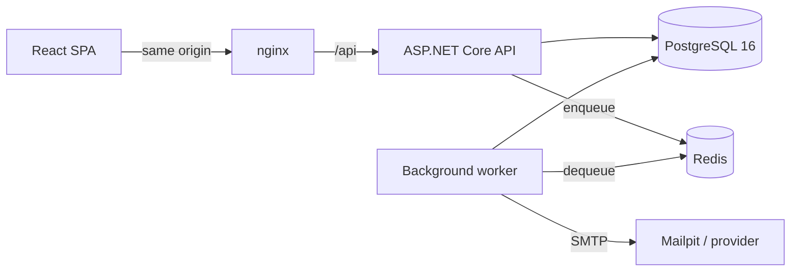

# Architecture, trade-offs and security decisions

This document explains the decisions behind the implementation: how a tenant
boundary is enforced, how a session works, what the audit trail guarantees, how
background work survives failure, and — where a decision could reasonably have
gone the other way — why it went this way.

---

## 1. Shape of the system



Two processes share one codebase and one database. The API answers requests;
the worker does everything that must not make a user wait or fail their request
— today, sending invitation emails and four periodic maintenance passes.

nginx serves the built frontend and proxies `/api` to the API, so the browser
sees **one origin**. That is not cosmetic: it keeps the refresh cookie
first-party, removes the need for CORS in the deployed configuration, and means
the app is never one misconfigured `Access-Control-Allow-Origin` away from
leaking credentials. The Vite dev server proxies the same way.

### Layering

```
Api / Worker  →  Infrastructure  →  Application  →  Domain
```

`Domain` has **no package references at all**. That constraint is what makes
the permission matrix and the membership invariants testable as pure functions,
with no database, HTTP context or DI container in sight — and it is why those
tests run in milliseconds and read like a specification.

**The one deliberate compromise:** `Application` depends on EF Core and
consumes `DbSet<T>` through an `IWorkspaceDb` interface, rather than a set of
hand-rolled repositories. Repositories over an ORM that is already a repository
tend to leak — either `IQueryable` escapes anyway, or the interface grows one
method per query until it mirrors the call sites. The cost of this choice is
that swapping the ORM would touch the application layer; the benefit is that
each use case expresses exactly the query it needs, transactions stay explicit
and obvious, and there is one less layer to read. Given a brief where the
interesting risk is tenant isolation rather than storage portability, that
trade seemed right.

---

## 2. Multi-tenancy

**The requirement:** no cross-organization data access, ever.

A shared database with a tenant discriminator was chosen over a
database-per-tenant or schema-per-tenant model: with an unknown and potentially
large number of small tenants, per-tenant databases turn migrations and
connection pooling into an operational problem, and buy isolation that can be
achieved in-process. The cost is that isolation now depends on getting queries
right — so it is enforced in **three independent places**, none of which relies
on application code remembering to do the right thing.

### Layer 1 — the tenant is resolved from the route, never from input

Every tenant-scoped route lives under `/api/organizations/{organizationId}`,
and the whole group carries `TenantResolutionFilter`. It takes the
authenticated user id from the token, looks up the membership row for that
organization, and pins the request's `ITenantContext` to it.

Three properties follow:

- **Nothing a client sends can set the tenant or the role.** The body, headers
  and query string are not consulted; the token carries identity only.
- **A role change takes effect immediately.** The role comes from the database
  on every request, so a demotion or removal applies to the caller's very next
  call rather than when their token expires.
- **A non-member gets `404`, not `403`.** Answering "forbidden" would confirm
  that an organization with that id exists, which turns the endpoint into an
  oracle for probing other tenants. Every cross-tenant test asserts `404`.

### Layer 2 — a query filter on every tenant-owned entity

`WorkspaceDbContext` applies a global query filter to each entity implementing
`ITenantOwned` (and to `AuditLog`). A query that forgets its own organization
predicate still cannot see another tenant's rows.

It **fails closed**: when no tenant has been resolved, the filter compares
against `Guid.Empty`, which no row ever holds, so the result is empty rather
than global.

Query filters do not apply to inserts, so `SaveChangesAsync` adds the matching
guard: inserting a tenant-owned row whose organization is not the resolved one
throws. A coding mistake becomes an immediate exception instead of a
cross-tenant write.

Three reads legitimately cross tenants, and all three go through one
deliberately greppable method, `IWorkspaceDb.CrossTenant<T>()`:

| Call site | Why it must cross | What constrains it |
| --- | --- | --- |
| `AuthService.GetMeAsync` | "Which organizations am I in?" has no single tenant | The caller's own user id |
| `TenantResolutionFilter` | This query is what *establishes* the tenant | The caller's user id and the requested organization |
| `InvitationService` (preview, accept, worker reads) | Membership is exactly what does not exist yet | A single-use 256-bit token hash, or a job's invitation id |

### Layer 3 — the database

- `tasks` references `projects` through a **composite foreign key**
  `(organization_id, project_id) → (organization_id, id)`. A task whose
  organization differs from its project's is not merely rejected by code, it is
  unrepresentable.
- Partial unique index: one *pending* invitation per address per organization,
  while leaving accepted, revoked and expired ones alone.
- Cascades are explicit: deleting an organization removes its memberships,
  invitations, projects and tasks; deleting a user unassigns their tasks rather
  than deleting the work.

**What was considered and not done: PostgreSQL row-level security.** RLS would
add a fourth layer that holds even for a hand-written query or a psql session.
It was left out because making it work with a pooled connection means setting a
session variable per transaction through an EF interceptor and keeping that in
step with the pool — a mechanism that is easy to get subtly wrong, and whose
failure mode is silent. Three enforced layers with tests that prove them seemed
more honest than four where one might not actually be engaged. If this went to
production with a compliance requirement, RLS would be the next addition, with
tests that connect directly and assert the policy.

---

## 3. Authentication and sessions

**Access tokens** are short-lived (15 minutes) HMAC-SHA256 JWTs carrying
identity only — subject, email, display name, token id. Deliberately **no role
or permission claim**: a token is valid for minutes, while a revoked role must
take effect at once. Authorization is resolved per request instead.

**Refresh tokens** are not JWTs. They are 256 bits from the system CSPRNG,
stored only as a SHA-256 hash. (A hash of a high-entropy random value needs no
salt or stretching — there is nothing to guess.) They **rotate on every use**:
the old row is revoked and points at its replacement, with the whole chain
sharing a `chain_id`.

Presenting an already-rotated token means it was captured. The response is to
revoke the **entire chain** and audit the event — the legitimate user is signed
out, which is the correct outcome when a session is known to be compromised.
The integration tests assert exactly this: after a replay, even the newest
token stops working.

**Delivery:** the refresh token is set as an `HttpOnly`, `SameSite=Lax`,
`Secure` cookie scoped to `/api/auth`. The frontend cannot read it, so an XSS
bug finds no stored credential; the access token lives only in a JavaScript
variable and is gone on reload (the app silently refreshes on startup). The
token also appears in the response body **only** when
`Auth:ReturnRefreshTokenInBody` is enabled, which is off by default and exists
for native and CLI clients. `SameSite=Lax` rather than `Strict` because the
invitation flow sends people here from an email client, and a `Strict` cookie
would not travel on that first navigation.

**Passwords** use ASP.NET Core Identity's hasher: PBKDF2-HMAC-SHA512, 128-bit
random salt, 210,000 iterations (OWASP's 2023 figure). Argon2id is the stronger
primitive, but every .NET implementation is a third-party native dependency,
while this one ships with the framework and is widely reviewed. The verifier
reports when a stored hash used weaker parameters, so raising the cost later
re-hashes everyone transparently on their next sign-in; switching to Argon2id
is a change to one class. Policy follows NIST SP 800-63B: length (12–128)
rather than composition rules, plus a small deny list and a check against the
user's own email and name. The upper bound is a denial-of-service guard —
hashing is deliberately expensive.

**Failure handling.** Every sign-in failure returns one generic message —
unknown account, wrong password, disabled, locked, all identical — and an
unknown address still pays for a hash verification, so timing does not reveal
which accounts exist. Ten consecutive failures lock an account for 15 minutes,
and the lock is never disclosed. Registration is the one place existence is
revealed (a duplicate address returns `409` so the user can go and sign in);
that is a conscious usability trade, and it is noted here rather than hidden.

---

## 4. Authorization

Four roles — Viewer, Member, Admin, Owner — map to permissions through a single
static matrix in `RolePermissions`. Endpoints declare the **permission** they
need, never a role, so adding a role is a change to the matrix and nothing
else. The matrix is cumulative (each role is a superset of the one below), and
an unmapped role grants nothing: it fails closed.

Authorization is checked **twice on purpose**: an endpoint filter rejects early
at the edge, and the use-case service re-checks the same permission. The
duplication means a new endpoint that forgets its filter is still not an open
door.

Some rules depend on *who the target is* and cannot live in a static matrix.
Those are pure functions in `MembershipRules`, unit-tested exhaustively:

- An admin may manage members, viewers and other admins, but **not owners** —
  otherwise an admin could demote every owner and take the tenant.
- Only an owner can grant Owner, so privilege never escalates above the actor.
- **Nobody changes their own role**, in either direction.
- An organization always keeps **at least one owner**; the last one cannot be
  demoted, removed or leave.
- A task's assignee must be a member of the same organization.

Task editing is row-level: Admins and Owners hold `TaskUpdateAny`, a Member
holds `TaskUpdateOwn` and may edit only tasks they created or are assigned to.
That check cannot sit in an endpoint filter, because it depends on the row, so
it lives in `TaskService` where the row is in hand.

**The frontend makes no authorization decisions.** It receives the caller's
permission list from `/api/auth/me` and uses it to decide what to render.
Hiding the audit link from a member saves them a pointless `403`; it protects
nothing. Every integration test for a denial calls the API directly.

---

## 5. Audit trail

Audit entries are written through `IAuditWriter`, which adds the row to the
**same change tracker** as the action being audited. One `SaveChangesAsync`
commits both, so an action and its audit record are atomic: there is no path
that changes data without recording it, and no orphan record of something that
did not happen. Commands are written as a single `SaveChanges`, which means a
single transaction without explicit transaction scopes.

**Immutability is enforced twice.** The application refuses to modify or delete
an audit row (`SaveChangesAsync` throws), and the database rejects `UPDATE`,
`DELETE` *and* `TRUNCATE` with a trigger. The second one is what makes the
trail evidence rather than a convention: bypassing the application does not
help. Both are tested.

**The trail outlives what it describes.** `audit_logs` has no foreign keys —
organization and actor ids are plain values. Deleting a tenant therefore leaves
its history intact, including the record of the deletion, and no `ON DELETE`
action ever needs to mutate a row the trigger forbids changing. The actor's
email is denormalized so entries stay readable after an account is gone.

**Scoping.** Account-level events — sign-in, failed sign-in, refresh replay —
carry no organization, so they never appear in any tenant's trail; they are for
operators reading server logs. Tenant events are readable by Admins and Owners
only, filtered to the resolved organization, and the API exposes no write, edit
or delete path at all.

Metadata is `jsonb`, and the writer's contract is explicit: never credentials,
tokens or hashes. A failed sign-in records `reason: bad_password`, not the
password — asserted in a test.

---

## 6. Background work

Invitation email is deferred so that a slow or unavailable mail server cannot
make a user's request fail or hang.

**Queue design.** Four Redis keys: `ready` (FIFO list), `processing` (sorted
set scored by pickup time), `scheduled` (sorted set scored by run time) and
`dead` (capped list). Dequeue pops from `ready` and records the job as in-flight
in **one Lua script**, so a worker that dies immediately after the pop cannot
lose the job: it stays in `processing` until the visibility timeout returns it.

That makes delivery **at-least-once**, so handlers are idempotent — the
invitation handler re-checks the invitation's status before sending, and a job
for a deleted invitation is dropped rather than retried.

Failures retry with exponential backoff and full jitter (5s, 10s, 20s, 40s,
capped at 15 minutes), then dead-letter after five attempts. Jitter matters
when a mail provider has an outage: without it, every invitation queued in that
window retries in lockstep.

Polling rather than a blocking `BRPOPLPUSH`: StackExchange.Redis multiplexes
one connection, so a blocking command would stall every other operation on it.
The cost is up to one poll interval of latency, which an email can afford.

**Why not Hangfire or Redis Streams.** This needs four operations and the exact
semantics above. The whole implementation is a few hundred readable, tested
lines, with an in-memory implementation of the same interface that lets tests
drive it deterministically. A system with many job types, or one needing a
dashboard and cron syntax, should use the library instead.

**Enqueue-after-commit, and the reconciliation pass.** The job is enqueued only
after the transaction commits, so the worker can never pick up an invitation
that does not exist yet. If the enqueue itself fails — Redis down, process
killed between the two steps — the invitation is left with
`DeliveryStatus = Pending` and a periodic pass re-queues it.

That is deliberately **smaller than a transactional outbox**: it costs one
periodic query instead of an outbox table plus a dispatcher, and the only price
is that a lost enqueue is noticed within a minute rather than immediately. The
token cannot be recovered from its stored hash, so reconciliation rotates it
before re-queuing — safe precisely because the original never reached anyone.
At higher volume, or where the job is money rather than email, the outbox is
the right answer.

The maintenance pass also promotes scheduled retries, recovers jobs from dead
workers, and marks expired invitations so the UI stops offering to resend links
nobody can redeem.

---

## 7. Data model decisions

- **UUID v7 identifiers**, generated by the application. Globally unique like a
  v4 GUID, but time-ordered, so index inserts stay at the right-hand edge of
  the B-tree instead of scattering. Application-side generation lets a handler
  reference an entity — in an audit record or a job payload — before the
  transaction commits.
- **Tasks carry `organization_id`** even though it is derivable through the
  project. One extra column buys a uniform tenant filter with no join, and the
  composite foreign key described above.
- **Enums are stored as integers**, which keeps role ordering meaningful for
  sorting. The API serializes them as *names*, so clients never depend on a
  numeric value that could shift.
- **snake_case names** via a small convention in the DbContext rather than a
  package: the schema reads naturally in `psql` and in migration SQL, at the
  cost of about thirty lines and one less dependency to pin.
- **Migrations are authored SQL** applied by EF Core. The partial index, the
  composite key and the audit trigger are all clearer as DDL, and the same file
  can be run directly with `psql` — which is how the schema's guarantees were
  verified. The consequence is stated in the migrations README: there is no EF
  model snapshot, so the next migration is written as SQL too.
- **Hard delete for organizations**, gated on the caller echoing the
  organization's slug, because an irreversible whole-tenant operation should
  not be reachable by a mistyped URL. A production system would soft-delete
  with a retention window; the audit trail surviving deletion is the piece that
  matters most, and it is implemented.

---

## 8. Errors, validation and input

Every failure is an RFC 9457 problem document with a stable, machine-readable
`code`, the HTTP status, and a `correlationId` that also appears on the
response header and on every audit row the request produced.

- Domain failures carry their own status and code (`not_found`, `forbidden`,
  `conflict`, `validation_failed`).
- Validation is FluentValidation, applied by an endpoint filter before the
  handler runs, returning `422` with per-field messages keyed the way the
  client sent them.
- Unique-constraint violations are mapped centrally to `409`. A check-then-insert
  would be a race; the database is the only thing that can decide atomically.
- A `500` returns the correlation id and nothing else. Exception messages
  contain connection strings, SQL and paths, so they are logged, never
  returned — only Development includes detail. A test asserts that malformed
  JSON produces a problem document with no stack trace and no type names.
- Paging bounds are enforced server-side (max 100 per page), so a client cannot
  request a whole table.

Other hardening: per-address rate limits on authentication and anonymous
invitation lookup; `nosniff`, `DENY`, `no-referrer`, a restrictive CSP and
`Cache-Control: no-store` on every response; forwarded headers honoured only
because the API sits behind nginx on a private network — a directly exposed API
must not do that, or clients could spoof their address and defeat rate limiting.

---

## 9. Testing strategy

Two suites, with different jobs.

**Unit tests** cover what must never drift and can be stated exactly: the
permission matrix (including that roles are cumulative and that an unknown role
grants nothing), the membership invariants, the password policy, slug
generation, the retry schedule, token issuance and hashing, and queue
semantics.

**Integration tests** run the real pipeline — JWT authentication, the tenant
filter, EF query filters, Postgres constraints and triggers — against a
throwaway database per run. An in-memory provider was rejected deliberately: it
has no partial indexes, no composite foreign keys and no triggers, so it would
silently drop exactly the guarantees worth testing.

Two components are substituted, both to make assertions possible rather than to
avoid work: the queue runs in memory so a test can read the enqueued job, and
email is captured so a test can read what a recipient would receive.

One detail worth calling out: the invitation tests obtain the token **from the
job payload**, because that is the only place it exists outside the email. The
test therefore proves the property it depends on — the API never returns the
token and the database stores only its hash.

---

## 10. Security decisions at a glance

| Decision | Why |
| --- | --- |
| Tenant from route + membership lookup, never from client input | A client cannot assert which tenant or role it has |
| `404` instead of `403` for non-members | The API cannot be used to probe for other tenants |
| Query filter + insert guard + composite FK | Isolation survives a forgotten `WHERE` |
| No role claims in the token | Revocation is immediate, not token-lifetime-delayed |
| Rotating refresh tokens, hashed at rest, chain revoked on replay | A stolen token is single-use and its reuse ends the session |
| HttpOnly cookie, access token in memory only | XSS finds no stored credential |
| PBKDF2-HMAC-SHA512 at 210k iterations, with rehash-on-verify | Framework primitive, upgradeable without a password reset |
| Identical sign-in failures, timing-equalized, with lockout | No account enumeration, blunted online guessing |
| Permission checked at the edge *and* in the service | A forgotten filter is not an open door |
| Audit written in the action's transaction, immutable in the database | The trail cannot be edited, skipped or truncated |
| Problem documents without exception detail | No connection strings or paths in error responses |
| Secrets only from the environment; startup refuses the example key | A committed placeholder cannot become a production key |

---

## 11. What I would do next

In the order I would actually do it:

1. **Password reset and email verification.** The worker, the token pattern
   (random value, hash at rest, single use, expiry) and the email templates are
   already there; this is mostly wiring.
2. **PostgreSQL row-level security** as a fourth isolation layer, with tests
   that connect directly to prove the policy engages.
3. **A transactional outbox** if background work grows beyond email — the
   reconciliation pass is the right size for today, not for a payment.
4. **Soft delete with a retention window** for organizations and projects.
5. **Structured logging and tracing** (OpenTelemetry) exporting traces and
   metrics; the correlation id is already threaded through requests, audit rows
   and jobs, so it is a matter of exporting it.
6. **Argon2id** for password hashing once a maintained managed implementation
   is acceptable — the rehash-on-verify path is already in place.
7. **A distributed rate-limit store.** The current limiter is per-instance, so
   limits multiply by replica count; Redis-backed counters fix that.

## 12. Known limitations

- Rate limiting is in-process (see above).
- Migrations run on API startup by default, which does not suit several
  replicas starting at once; `Database:MigrateOnStartup=false` plus a release
  step is the production answer, and is documented in the README.
- Deleting a user is blocked while they have invitations they sent
  (`ON DELETE RESTRICT`), to preserve who-invited-whom. There is no user
  deletion endpoint, so this surfaces only in direct database work.
- There is no EF model snapshot, by the choice explained above; the next
  migration is written as SQL.
- The invitation token travels in the queue payload. Redis is not exposed
  outside the private network, and the alternative — storing a recoverable
  token — is worse. Encrypting job payloads would close it properly.
