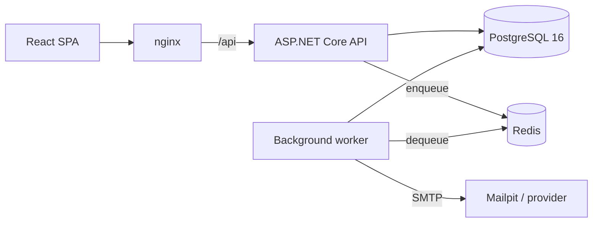

# architecture

## the system

sOoo itz 2 processes sharing one codebase n one database. the API answers
requests, the worker does the stuff that shudnt block or break a request —
rn thatz invitation email plus 4 periodic maintenance passes.

nginx serves the frontend n proxies `/api`, sOoo the browser only ever sees
one origin. thatz what keeps the refresh cookie first-party n means i dont
need CORS at all in the deployed setup. the Vite dev server proxies the same
way.

projects depend inward: `Api`/`Worker` → `Infrastructure` → `Application` →
`Domain`. `Domain` has zero package refs, which is why the permission matrix n
the membership rules can be tested as plain functions w/o a db.

**tradeoff:** `Application` uses EF Core `DbSet<T>` thru an `IWorkspaceDb`
interface insteada custom repositories. repositories on top of an ORM usually
leak `IQueryable` anyway or grow one method per query til they just mirror the
call sites. the cost is that swapping ORM wud touch the application layer, n
im fine w/ that.

## tenancy

one database w/ an organization discriminator, not a db per tenant. per-tenant
databases make migrations n pooling a real ops problem once u have lots of
small tenants. sOoo isolation is enforced in 3 separate places instead.

**1. the tenant comes from the route, nvr from the client.** tenant-scoped
routes live under `/api/organizations/{organizationId}` n the whole group runs
`TenantResolutionFilter`, which loads the callers membership n pins
`ITenantContext`. nuthin in the body, headers or query string can set the org
or the role. the role is read per request sOoo a demotion or a removal applies
on the callers *next* call, not whenever their token happens to expire.

n if ur not a member u get 404, not 403 — a 403 wud confirm the org exists,
which is exactly the thing i dont want leaking.

**2. a query filter on evry tenant-owned entity.** a query that forgets its own
organization predicate still returns nuthin from other tenants. when no tenant
is resolved the filter compares against `Guid.Empty`, sOoo it fails closed
insteada open. query filters dont apply to inserts tho, sOoo `SaveChangesAsync`
also rejects writing a tenant-owned row into a different org.

3 reads legitimately cross tenants n they all go thru
`IWorkspaceDb.CrossTenant<T>()`, which exists purely sOoo u can grep them:

| call site | constrained by |
| --- | --- |
| "which orgs am i in?" (`/auth/me`) | the callers own user id |
| tenant resolution | the callers user id + the requested org |
| invitation preview, accept, worker reads | a 256-bit single-use token hash, or the jobs invitation id |

**3. the database itself.** `tasks` points at `projects` w/ a composite key
`(organization_id, project_id) → (organization_id, id)`, sOoo a task in one
tenant pointing at another tenants project literally cant be represented. n
theres a partial unique index allowing one *pending* invitation per address per
org while leaving accepted/revoked ones alone.

**what i skipped: row-level security.** it wud add a layer that holds even for
a hand-written query, but w/ pooled connections u need a session variable set
per transaction thru an EF interceptor, n when that breaks it breaks silently.
3 layers i can actually test beat 4 where one might not be engaged. itz the
first thing id add for a compliance requirement tho.

## auth

access tokens are 15-min HMAC-SHA256 JWTs carrying identity only. no role n no
permission claim, cuz a token is valid for minutes n a revoked role has to
apply immediately.

refresh tokens arent JWTs. theyre 256-bit random values stored only as SHA-256
hashes, rotated on evry use, w/ the whole chain sharing a `chain_id`. if
sumthin presents an already-rotated token that means it got captured, sOoo i
revoke the entire chain n audit it. yes that signs the real user out — thatz
the correct outcome when a session is known to be compromised.

delivery is an `HttpOnly`, `SameSite=Lax`, `Secure` cookie scoped to
`/api/auth`. it only shows up in the response body when
`Auth:ReturnRefreshTokenInBody` is on, which is off by default n exists for
non-browser clients. `Lax` n not `Strict` cuz invitation links arrive from an
email client n a Strict cookie wudnt travel on that first navigation.

passwords use ASP.NET Core Identitys PBKDF2-HMAC-SHA512 at 210,000 iterations
(OWASP 2023). argon2id is stronger ngl, but evry .NET implementation is a
third-party native dep, n the verifier here reports outdated params sOoo i can
raise the cost later n hashes upgrade on next sign-in. policy follows NIST SP
800-63B: length 12-128, no composition rules, a small deny list, n no reusing
ur own email or name.

evry sign-in failure returns the same message, n an unknown address still pays
for a hash verification sOoo timing doesnt tell u which accounts exist. 10
consecutive failures locks the account for 15 min n i dont disclose that
either. registration does report a duplicate address — thatz a conscious
tradeoff, cuz thatz the one endpoint where the user genuinely needs to know.

## authorization

4 roles map to permissions thru one static matrix. endpoints declare a
permission, nvr a role. the matrix is cumulative n an unmapped role gets
nuthin.

checks happen twice on purpose: an endpoint filter rejects early, n the service
checks again, sOoo an endpoint that forgets its filter still isnt an open door.

rules that depend on *who the target is* live in `MembershipRules`:

- an admin cant act on an owner or grant Owner
- nobody changes their own role
- an org always keeps at least one owner
- an assignee has to be a member of the same org

task editing is row-level: Admins n Owners hold `TaskUpdateAny`, a Member holds
`TaskUpdateOwn` n can only edit tasks they created or are assigned to. that
check needs the actual row sOoo it lives in `TaskService`.

the frontend makes zero authorization decisions. it reads the permission list
from `/auth/me` to decide what to render, n evry denial test calls the API
directly.

## audit

entries go into the same change tracker as the action, sOoo one
`SaveChangesAsync` commits both. theres no path that changes data w/o recording
it.

immutability is enforced twice: the app refuses to modify or delete an audit
row, n a trigger rejects `UPDATE`, `DELETE` n `TRUNCATE`. the second one is
what makes the trail evidence insteada just a convention — bypassing the app
doesnt help u.

`audit_logs` has no foreign keys at all, sOoo deleting a tenant leaves its
history intact, including the record of the deletion itself. the actors email
is denormalized sOoo entries stay readable after an account is gone.

account-level events (sign-in, failed sign-in, token replay) carry no org n
nvr show up in a tenants trail. metadata is `jsonb` n nvr holds credentials or
tokens.

## background work

4 redis keys: `ready` (list), `processing` (sorted set by pickup time),
`scheduled` (sorted set by run time) n `dead`. dequeue pops n records the job
in-flight inside one Lua script, sOoo a worker that dies right after the pop
doesnt lose it — the visibility timeout brings it back. delivery is therefore
at-least-once n handlers are idempotent.

retries are exponential backoff w/ full jitter (5s, 10s, 20s, 40s, capped at 15
min) n dead-letter after 5 attempts. the jitter matters when a mail provider
has an outage, otherwise evry invitation queued in that window retries in
lockstep lol.

polling insteada `BRPOPLPUSH` cuz StackExchange.Redis multiplexes one
connection n a blocking command wud stall everything else on it.

jobs are enqueued *after* the transaction commits, sOoo the worker cant see an
invitation that doesnt exist yet. if the enqueue itself fails the invitation is
left pending n a periodic pass re-queues it, rotating the token first since the
original nvr got delivered anyway. thatz smaller than a transactional outbox:
one periodic query insteada an outbox table + dispatcher, n the only cost is
noticing a lost enqueue within a minute insteada instantly. higher volume, or
work thatz money n not email, wud justify the outbox.

## data model

- UUID v7 ids generated in the app: unique but time-ordered sOoo index inserts
  stay at the right-hand edge, n i can reference an entity before its
  transaction commits
- tasks carry `organization_id` even tho itz derivable, which buys a uniform
  filter w/o a join plus the composite FK above
- enums stored as ints sOoo role ordering sorts right, serialized as names sOoo
  clients nvr depend on a number
- migrations are SQL applied by EF Core. the partial index, composite key n
  audit trigger all read better as DDL n the files can just be run w/ `psql`.
  consequence: theres no EF model snapshot, sOoo the next migration is written
  as SQL too
- deleting an org is a hard delete gated on echoing the slug. prod wud
  soft-delete w/ a retention window

## errors n input

failures are RFC 9457 problem documents w/ a stable `code` n a `correlationId`
that also shows up on the response header n on any audit rows the request
produced. validation runs in an endpoint filter n returns 422 w/ per-field
messages. unique-constraint violations map to 409 centrally, cuz a
check-then-insert is a race. a 500 returns the correlation id n nuthin else.

also btw: per-address rate limits on auth n anonymous invitation lookup,
`nosniff`, `DENY`, `no-referrer`, a tight CSP n `no-store` on evry response, n
forwarded headers trusted only cuz the API sits behind nginx on a private
network.

## testing

unit tests cover the permission matrix, membership rules, password policy, slug
generation, retry schedule, token issuance n queue semantics.

integration tests run the real pipeline against a real PostgreSQL w/ a
throwaway database per run. an in-memory provider has no partial indexes, no
composite FKs n no triggers, sOoo it wud silently drop exactly the guarantees
worth testing. 2 things are swapped to make assertions possible: the queue runs
in memory sOoo a test can read the enqueued job, n email is captured.

the invitation tests read the token out of the job payload, which is the only
place it exists outside the email — sOoo those tests prove the property they
rely on.

## known limitations

- rate limiting is per-instance, sOoo limits multiply by replica count. a
  redis-backed store fixes it
- migrations run on API startup by default which doesnt suit several replicas
  starting at once. `Database:MigrateOnStartup=false` + a release step is the
  prod answer
- deleting a user is blocked while invitations they sent exist
  (`ON DELETE RESTRICT`), to preserve who invited who. theres no user deletion
  endpoint anyway
- the invitation token travels in the queue payload. redis isnt exposed outside
  the private network, n encrypting job payloads wud close this properly
- no password reset, email verification, SSO, attachments or realtime updates.
  those are features, not missing guarantees

## next

1. password reset n email verification, reusing the token pattern + worker
2. row-level security as a 4th isolation layer
3. transactional outbox if background work grows past email
4. soft delete w/ a retention window
5. OpenTelemetry traces n metrics — the correlation id is already threaded thru
   requests, audit rows n jobs
